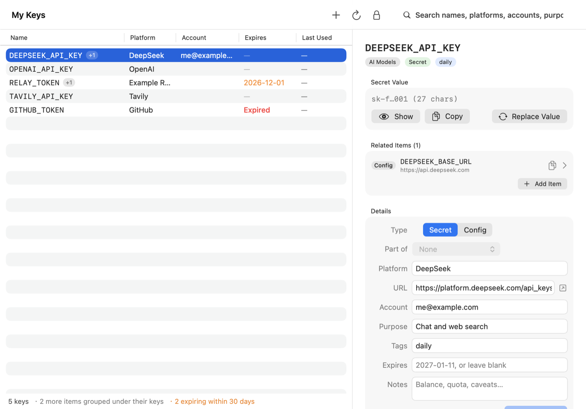

<div align="center">


# My Keys

**A local API-key manager for macOS: one file holds every key, you browse it in a native app, scripts and AI agents fetch keys by name.**

No account · No subscription · No cloud · No background service

[](LICENSE)
[](#install)
[](app)
[](bin/key)
[](https://github.com/Leoherbertsun/mykeys/releases)

[中文](README.md) · **English**

[Install](#install) · [Let your AI do it](#the-easy-way-let-your-ai-agent-do-it) · [Commands](#commands) · [Comparison](docs/comparison.en.md) · [Docs](#docs)



</div>

## Why

You get a new API key, then paste it into `.zshrc`, a project's `.env`, three MCP configs, and finally into a chat with your AI assistant. Months later the same key lives in eight places, and nobody remembers which ones are still used, which have expired, or which account they belong to.

My Keys does a few things, and does them well:

- 🗂 **One copy.** Every key lives in `~/.config/secrets/keys.env`, sourced by `~/.zshenv`. Every shell, script and AI agent sees `$NAME`, so existing scripts need no changes.
- 🚪 **Two doors, one file.** Humans use **My Keys.app**: Touch ID, search, filters, notes and expiry reminders. Scripts and agents use the **`key`** CLI. Both always agree.
- 🤖 **Agents fetch by name, never through chat.** New keys go from the clipboard straight into the file; agents only ever see masked values. MCP configs hold names, not plaintext.
- 📜 **One rulebook for every agent.** A single command writes the same rules into Claude Code, Codex and Gemini CLI global instructions.
- 🔗 **Secrets vs. config.** Base URLs, regions and app IDs hang under the key they belong to; the main list shows only real secrets.
- ✨ **Notes fill themselves in.** A built-in catalog of 70+ providers: add `OPENAI_API_KEY` and the platform, key-management URL and section are filled in.
- 🧹 **Migrate first.** `key scan` finds plaintext keys in shell configs, MCP configs and `.env` files; `key import` moves them in without the value ever showing on screen.
- ⏰ **Expiry alerts, encrypted backups.** Alerts land in the Reminders app 7 days ahead. Backups are password-protected disk images: double-click, type the password, done.

## Install

You need macOS 14+ and Xcode or the Command Line Tools (`xcode-select --install`).

```bash
git clone https://github.com/Leoherbertsun/mykeys.git ~/mykeys
cd ~/mykeys && ./install.sh
```

You get:

- `/Applications/My Keys.app`
- the `~/.local/bin/key` CLI
- `~/.config/secrets/keys.env` (mode 600)
- one `source` line in `~/.zshenv`

Re-running is safe; an existing keys file is never overwritten. For the CLI only (no Xcode needed), run `./install.sh --cli`.

A prebuilt app is available under [Releases](https://github.com/Leoherbertsun/mykeys/releases). It isn't notarized, so the first time you open it, choose "Open Anyway" in System Settings → Privacy & Security.

## The easy way: let your AI agent do it

After installing, tell your AI coding assistant (Claude Code, Codex, Cursor…):

> Follow `~/mykeys/docs/setup-with-ai.en.md` to organize the API keys on this Mac.

It follows that agent-facing playbook:

1. find and import stray plaintext keys;
2. complete the notes and attach configs to their keys;
3. switch MCP configs to fetch keys by name;
4. wire every local agent to the same rules;
5. run a health check.

It asks before touching your existing files.

From then on, adding a key takes two steps: **copy it**, then say **"save it as XXX_API_KEY, expires next March"**.

## Commands

| Command | What it does |
|---|---|
| `key add NAME` | Add or rotate a key from the clipboard, then clear the clipboard; known providers get notes filled in |
| `key ls [word]` | List entries grouped, secrets masked, config shown |
| `key set NAME url=… account=… expires=2027-03-01` | Edit notes; an expiry adds a Reminders alert 7 days ahead |
| `key get NAME` · `key run NAME… -- cmd` | Print a value · pass only the named keys to one command |
| `key copy NAME` | Copy to the clipboard, auto-cleared after 45 s (for web forms) |
| `key header NAME` | Print an auth header for HTTP MCP servers |
| `key scan` · `key import FILE VAR` | Find stray plaintext keys · import one |
| `key agents --write` | Write the shared rules into each agent's global instructions |
| `key catalog [word]` | Browse the built-in provider catalog |
| `key check` | Health check: expiry, duplicates, plaintext copies, shell wiring, backup, agents |
| `key backup` · `key restore FILE` | Encrypted backup · restore |

`key help` lists everything; `key help mcp` explains MCP wiring. The UI and messages follow your system language, Chinese or English.

## How it works

```
                  ~/.config/secrets/keys.env      ← the only copy, mode 600
                 ▲             ▲              ▲
       source    │      key    │       key    │
                 │             │              │
 shells & scripts┘   AI agents ┘   My Keys.app ┘
     ($NAME)        (fetch/store)   (browse/edit)
```

The file is plain `export NAME='value'` lines, each with a `#: platform=… url=… expires=…` notes line above it that shells ignore. See [storage conventions](docs/conventions.en.md).

## Docs

| | |
|---|---|
| [Let an AI agent set it up](docs/setup-with-ai.en.md) | The full playbook for an AI agent to follow |
| [Storage conventions](docs/conventions.en.md) | Naming, secrets vs. config, notes, sections and catalog, file format |
| [How agents work together](docs/agents.en.md) | Rule distribution, MCP wiring, new Macs and sharing |
| [Comparison](docs/comparison.en.md) | cc-switch, dotenvx, varlock, fnox, 1Password and 20+ other projects |

## FAQ

<details>
<summary><b>Keys are stored in plaintext. Is that safe?</b></summary>

The file is mode 600 and your disk is encrypted by FileVault. My Keys stops keys from sprawling into configs and chat logs; it does not protect against malware already running as you, since any program you run can read environment variables. Touch ID in the app only keeps onlookers out. If you need encryption at rest or agents that never see values, see the alternatives in the [comparison](docs/comparison.en.md).
</details>

<details>
<summary><b>Will my AI agent leak keys into the chat?</b></summary>

The rules tell agents never to print values or `cat` the file, and everything `key` prints is masked. Adding goes through the clipboard and importing reads the source file directly, so values never pass through the agent. Commands an agent runs can still read environment variables, so be aware of that.
</details>

<details>
<summary><b>GUI apps don't see my environment variables.</b></summary>

Use `key get NAME` or `key run NAME -- cmd`. That's how Claude Desktop's MCP servers are wired; see [How agents work together](docs/agents.en.md).
</details>

<details>
<summary><b>Does it work with bash?</b></summary>

Yes. Add `source ~/.config/secrets/keys.env` to `~/.bashrc`. `install.sh` only wires zsh, the macOS default.
</details>

## Contributing

Issues and PRs are welcome, especially more providers for the [catalog](bin/key) and support for more agents' global instruction files. See [AGENTS.md](AGENTS.md) for the layout, and run `test/selfcheck.sh` before sending a PR.

## License

[MIT](LICENSE)
