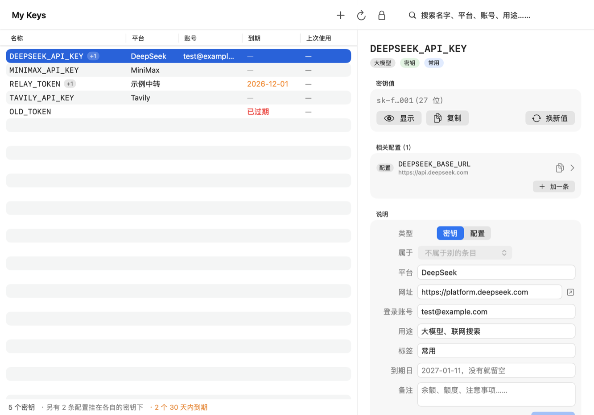

<div align="center">


# My Keys

**Mac 上的 API 密钥管家：一个文件存全部密钥，人用 App 看，脚本和 AI 按名字取。**

不要账号 · 不收费 · 不上云 · 不跑后台服务

[](LICENSE)
[](#安装)
[](app)
[](bin/key)
[](https://github.com/Leoherbertsun/mykeys/releases)

**中文** · [English](README.en.md)

[安装](#安装) · [交给 AI](#最省事的用法交给-ai) · [日常命令](#日常命令) · [和同类项目比](docs/comparison.md) · [文档](#文档)



</div>

## 为什么做它

拿到一个新的 API 密钥后，你往往要把它存进 `.zshrc`，抄进项目的 `.env`，再贴进 Claude、Cursor、Codex 的 MCP 配置，最后还要在聊天里发给 AI 助手。几个月后，同一个密钥散落在七八个地方：哪个还在用、哪个过期了、是哪个账号申请的，都说不清了。

My Keys 只做几件事，把它们做好：

- 🗂 **只有一份。** 所有密钥都在 `~/.config/secrets/keys.env`，由 `~/.zshenv` 自动加载。每个终端、脚本、AI 助手直接用 `$变量名`，现有脚本一行不用改。
- 🚪 **两扇门，同一个文件。** 人用 **My Keys.app**：Touch ID 解锁，能搜索、筛选、写说明、设到期提醒。脚本和 AI 用命令行工具 **`key`**。两边永远一致。
- 🤖 **AI 按名字取，不经过聊天。** 新密钥从剪贴板直接进文件，AI 只看到打码后的值。MCP 配置里只写名字，不写明文。
- 📜 **所有 AI 守同一套规则。** 一条命令把规则写进 Claude Code、Codex、Gemini CLI 的全局说明，换哪个 AI 都知道怎么用。
- 🔗 **密钥和配置分开。** 接口地址、地域、应用编号挂在所属密钥下面，主列表只放真正的秘密。
- ✨ **自动补说明。** 内置 70 多个常见平台的目录：录入 `OPENAI_API_KEY`，平台、管理密钥的网址、分类自动填好。
- 🧹 **先搬家，再管理。** `key scan` 找出散落在 shell 配置、MCP 配置、`.env` 里的明文，`key import` 原样收进来，值不出现在屏幕上。
- ⏰ **到期提醒、加密备份。** 到期前 7 天用系统“提醒事项”提醒你；备份是带密码的磁盘映像，双击输密码就能打开。

## 安装

需要 macOS 14 以上，以及 Xcode 或命令行工具（没有的话先运行 `xcode-select --install`）。

```bash
git clone https://github.com/Leoherbertsun/mykeys.git ~/mykeys
cd ~/mykeys && ./install.sh
```

装完会有这些：

- `/Applications/My Keys.app`
- 命令行工具 `~/.local/bin/key`
- 密钥文件 `~/.config/secrets/keys.env`（权限 600）
- `~/.zshenv` 里的一行自动加载

重复运行是安全的，已有的密钥文件不会被覆盖。只要命令行工具的话，用 `./install.sh --cli`，不需要 Xcode。

也可以在 [Releases](https://github.com/Leoherbertsun/mykeys/releases) 下载编译好的 App。它没有经过苹果公证，第一次打开要在“系统设置 → 隐私与安全性”里点“仍要打开”。

## 最省事的用法：交给 AI

装好后，对你常用的 AI 编程助手（Claude Code、Codex、Cursor……）说：

> 按 `~/mykeys/docs/setup-with-ai.md` 帮我把本机的 API 密钥整理好。

它会照着这份写给 AI 的说明做：

1. 找出散落的明文密钥，收进来；
2. 补全说明，把配置挂好；
3. 把 MCP 配置里的明文换成按名字取；
4. 让本机所有 AI 接入同一套规则；
5. 体检。

改你原有的文件之前，它会先问你。

以后新拿到一个密钥，只要两步：**复制它**，再对 AI 说 **“存成 XXX_API_KEY，明年 3 月到期”**。

## 日常命令

| 命令 | 作用 |
|---|---|
| `key add 名字` | 录入或换新，值取自剪贴板，存完清空剪贴板；常见平台自动补说明 |
| `key ls [关键词]` | 按组列出全部条目，密钥打码，配置直接显示 |
| `key set 名字 url=… account=… expires=2027-03-01` | 改说明；填了到期日会在“提醒事项”里提前 7 天提醒 |
| `key get 名字` · `key run 名字… -- 命令` | 取值 · 只把指定的密钥交给某个命令 |
| `key copy 名字` | 复制到剪贴板，45 秒后自动清空（给只能手动粘贴的网页用） |
| `key header 名字` | 给 HTTP 型 MCP 服务生成请求头 |
| `key scan` · `key import 文件 变量名` | 找散落的明文密钥 · 把它收进来 |
| `key agents --write` | 把密钥规则写进本机各个 AI 助手的全局说明 |
| `key catalog [关键词]` | 查看内置的平台目录 |
| `key check` | 体检：到期、重复、明文副本、终端接线、备份、AI 接入 |
| `key backup` · `key restore 文件` | 加密备份 · 从备份恢复 |

`key help` 列出全部命令，`key help mcp` 讲怎么给 MCP 服务配密钥。界面和提示跟随系统语言，中文或英文。

## 它是怎么工作的

```
                  ~/.config/secrets/keys.env      ← 唯一的一份，权限 600
                 ▲             ▲              ▲
       source    │      key    │       key    │
                 │             │              │
     终端和脚本 ──┘    AI 助手 ──┘   My Keys.app ─┘
     （$变量名）   （按名字取、存）  （看、搜、改）
```

文件就是普通的 `export 名字='值'`，每条上方有一行 `#: platform=… url=… expires=…` 的说明，shell 当作注释忽略。格式和约定见 [存储约定](docs/conventions.md)。

## 文档

| | |
|---|---|
| [让 AI 帮你配置](docs/setup-with-ai.md) | 交给 AI 照着做的完整步骤 |
| [存储约定](docs/conventions.md) | 命名、密钥和配置怎么分、记哪些说明、分类和平台目录、文件格式 |
| [AI 助手之间怎么协作](docs/agents.md) | 规则怎么分发、MCP 怎么接、换电脑和分享给别人 |
| [和同类项目比](docs/comparison.md) | cc-switch、dotenvx、varlock、fnox、1Password 等 20 多个项目的对比 |

## 常见问题

<details>
<summary><b>密钥是明文存的，安全吗？</b></summary>

文件权限是 600，硬盘有 FileVault 全盘加密。My Keys 防的是密钥散落到各种配置文件和聊天记录里，不防本机已经中毒的程序：同一用户下运行的程序都能读到环境变量。App 的 Touch ID 锁只是防别人顺手翻看。需要加密存储或“AI 完全碰不到值”的，见 [对比](docs/comparison.md) 里的其他方案。
</details>

<details>
<summary><b>AI 助手会不会把我的密钥发到聊天里？</b></summary>

规则明确要求 AI 不打印值、不 `cat` 文件；`key` 的所有输出也都已打码。录入走剪贴板，导入直接读原文件，值不经过 AI。但 AI 跑的命令确实能读到环境变量，这一点要有数。
</details>

<details>
<summary><b>图形界面启动的程序拿不到环境变量怎么办？</b></summary>

用 `key get 名字` 或 `key run 名字 -- 命令`。Claude 桌面版的 MCP 服务就是这样接的，见 [AI 助手之间怎么协作](docs/agents.md)。
</details>

<details>
<summary><b>支持 bash 吗？</b></summary>

支持。在 `~/.bashrc` 里加一行 `source ~/.config/secrets/keys.env` 即可。`install.sh` 默认只接 zsh，这是 macOS 的默认 shell。
</details>

## 参与

欢迎提 Issue 和 PR，特别是给 [平台目录](bin/key) 补充更多平台、支持更多 AI 助手的全局说明文件。开发说明见 [AGENTS.md](AGENTS.md)，改完请跑 `test/selfcheck.sh`。

## 许可

[MIT](LICENSE)
