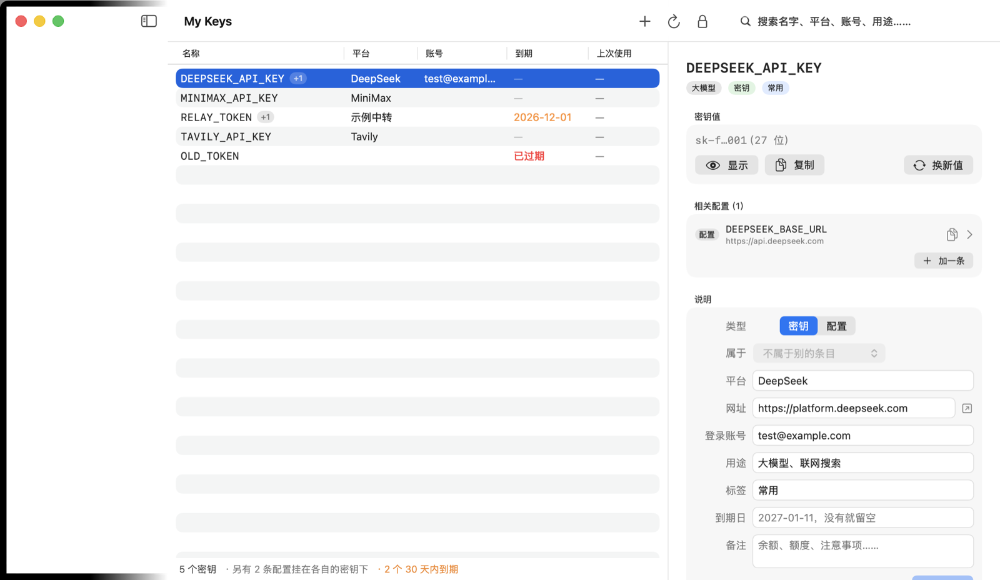

<p align="center"></p>

<h1 align="center">My Keys</h1>

<p align="center">给 Mac 用户的 API 密钥管家：一个文件存全部密钥，人用 App 看，脚本和 AI 按名字取。<br>
不要账号、不收费、不上云、不跑后台服务。</p>

<p align="center">中文 · <a href="README.en.md">English</a></p>



## 它解决什么问题

拿到一个新的 API 密钥后，你往往要把它存进 `.zshrc`，抄进某个项目的 `.env`，再贴进 Claude、Cursor、Codex 的 MCP 配置，最后还要在聊天里发给 AI 助手。几个月后，同一个密钥散落在七八个地方，你已经分不清哪个还在用、哪个过期了，也说不清是用哪个账号申请的。

My Keys 的做法很简单：

- **只有一份。** 所有密钥都在 `~/.config/secrets/keys.env`，由 `~/.zshenv` 自动加载，每个终端、脚本和 AI 助手都能直接用 `$变量名`。
- **两扇门，同一个文件。** 人用 **My Keys.app**（Touch ID 解锁，可以搜索、筛选、编辑说明）；脚本和 AI 用命令行工具 **`key`**。两边改的是同一个文件，永远一致。
- **AI 按名字取，不经过聊天。** 新密钥从剪贴板直接写进文件，AI 只看到打码后的值；配置 MCP 时写的是名字，配置文件里不再有明文。
- **所有 AI 守同一套规则。** `key agents --write` 把同一段规则写进 Claude Code、Codex、Gemini CLI 的全局说明，换哪个 AI 都知道密钥在哪、怎么取、不能做什么。

## 和现有方案比

| | My Keys | 1Password CLI | Doppler / Infisical | 直接写在 .zshrc |
|---|---|---|---|---|
| 费用 | 免费 | 约 36 美元/年 | 有免费档，团队收费 | 免费 |
| 需要账号、联网 | 不需要 | 需要 | 需要 | 不需要 |
| 脚本直接 `$变量名` | ✅ 自动加载 | 要包一层 `op run` | 要包一层 `doppler run` | ✅ |
| 图形界面、搜索、到期提醒 | ✅ | ✅ | 网页 | ❌ |
| AI 助手按名字取、不贴进聊天 | ✅ 自带规则 | 部分 | 部分 | ❌ |
| MCP 配置不放明文 | ✅ `key run` / `key header` | ✅ `op run` | ✅ | ❌ |
| 接口地址等配置挂在所属密钥下 | ✅ | ❌ | 按项目分 | ❌ |

My Keys 面向的是个人开发者在**自己的一台 Mac** 上管理几十个 API 密钥，不是团队密钥平台。团队共享、权限审计请选上面那些服务。

## 安装

需要 macOS 14 以上，以及 Xcode 或命令行工具（没有的话先运行 `xcode-select --install`）。

```bash
git clone https://github.com/Leoherbertsun/mykeys.git ~/mykeys
cd ~/mykeys && ./install.sh
```

装完会有：

- `/Applications/My Keys.app`
- `~/.local/bin/key`
- `~/.config/secrets/keys.env`（权限 600）
- `~/.zshenv` 里的一行自动加载

已有的密钥文件不会被覆盖，重复运行也安全。只想要命令行工具、不想编译 App，用 `./install.sh --cli`。

## 最省事的用法：交给 AI

装好后，对你常用的 AI 助手（Claude Code、Codex、Cursor……）说：

> 按 `~/mykeys/docs/setup-with-ai.md` 帮我把本机的 API 密钥整理好。

它会做这几件事：

1. 找出散落在 shell 配置、MCP 配置和 `.env` 里的明文密钥，收进 `keys.env`（值不经过聊天）；
2. 按平台补上说明，把接口地址这类配置挂到所属密钥下；
3. 把 MCP 配置里的明文换成按名字取；
4. 让本机所有 AI 助手接入同一套规则；
5. 最后跑一遍体检。

之后，新拿到一个密钥只要两步：复制它，再对 AI 说一句“存成 XXX_API_KEY，平台是 XX，明年 3 月到期”。

## 日常命令

| 命令 | 作用 |
|---|---|
| `key add 名字` | 录入或换新，值取自剪贴板，存完清空剪贴板 |
| `key add 名字 --kind config --group 主条目` | 存一条配置（如接口地址），挂在所属密钥下 |
| `key ls [关键词]` | 按组列出全部条目，密钥打码，配置直接显示 |
| `key set 名字 platform=… url=… expires=…` | 改说明；填了到期日会在“提醒事项”里提前 7 天提醒 |
| `key get 名字` / `key run 名字… -- 命令` | 取值；只把指定密钥交给某个命令 |
| `key copy 名字` | 复制到剪贴板，45 秒后自动清空（给只能手动粘贴的网页用） |
| `key header 名字` | 给 HTTP 型 MCP 生成请求头 |
| `key scan` / `key import 文件 变量名` | 找散落的明文密钥 / 把它收进来 |
| `key agents --write` | 把密钥规则写进本机各个 AI 助手的全局说明 |
| `key check` | 体检：到期、重复、明文副本、终端接线、备份、AI 接入 |
| `key backup` | 加密备份成带密码的磁盘映像，双击输密码就能打开 |

`key help` 列出全部命令，`key help mcp` 讲怎么给 MCP 服务配密钥。

## 文档

- [让 AI 帮你配置](docs/setup-with-ai.md)：交给 AI 助手照着做的完整步骤
- [存储约定](docs/conventions.md)：命名、密钥和配置怎么分、每个字段记什么，以及文件格式
- [AI 助手之间怎么协作](docs/agents.md)：规则怎么分发、MCP 怎么接、换 AI 或换电脑怎么办

## 安全上要知道的

- 密钥文件是**明文**，靠文件权限 600 和 macOS 的 FileVault 全盘加密保护。它防的是“散落、泄露到配置和聊天里”，不防本机已经中毒的程序：同一用户下运行的程序都能读环境变量。
- App 的 Touch ID 锁是为了防别人顺手翻看，并不额外加密文件。
- 加密备份用的是 macOS 自带的 AES-256 磁盘映像，密码存在登录钥匙串里。

## 许可

[MIT](LICENSE)
